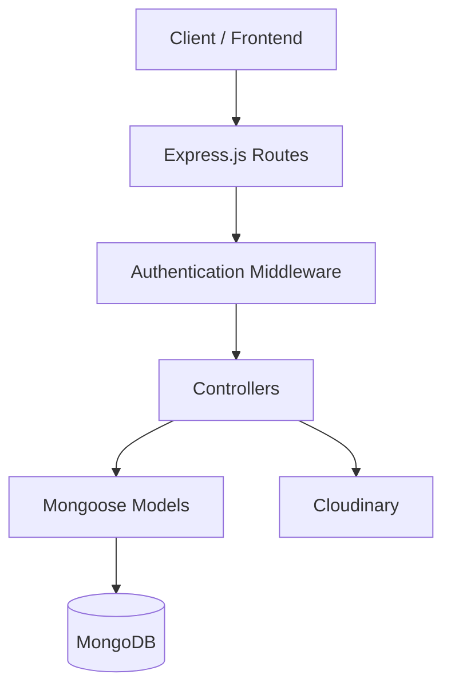

# 🚀 Social Media Backend

\<h1 align="center">🌐 Social Media Platform – Backend\</h1>

\<p align="center">   A powerful RESTful API backend for a modern social media platform.   Built with Node.js, Express.js, MongoDB and JWT Authentication. \</p>

\<p align="center">   \   \   \   \ \</p>

\<p align="center">   \   \   \ \</p>

---

## 📌 About The Project

This project is a RESTful API backend for a social media application that allows users to create accounts, manage profiles, upload videos, share tweets, like content, and subscribe to other users.

The backend is developed using Node.js and Express.js with MongoDB as the database.

It follows a modular architecture using controllers, models, routes, middlewares, and utility functions.

## ✨ Key Features

- 🔐 **Authentication & Authorization**

  - User registration and login
  - JWT-based authentication
  - Secure password hashing
  - Protected routes

- 👤 **User Management**

  - User profile management
  - Update avatar and cover images
  - Change password
  - User channel profiles

- 🎥 **Video Management**

  - Upload and publish videos
  - Upload video thumbnails
  - Update and delete videos
  - Manage video publishing status

- 📝 **Tweet Management**

  - Create tweets
  - Update tweets
  - Delete tweets
  - Get user tweets

- ❤️ **Social Interactions**

  - Like and unlike tweets
  - Subscribe and unsubscribe to channels
  - Manage user subscriptions

- ☁️ **Cloud Storage**

  - Cloudinary integration
  - Image and video uploads

## 🛠️ Tech Stack

| Technology | Purpose              |
| ---------- | -------------------- |
| Node.js    | JavaScript runtime   |
| Express.js | Backend framework    |
| MongoDB    | NoSQL database       |
| Mongoose   | Database modeling    |
| JWT        | Authentication       |
| bcrypt     | Password hashing     |
| Cloudinary | Media storage        |
| JavaScript | Programming language |

## 📂 Project Structure

```text
backend/
│
├── public/
│
├── src/
│   ├── controllers/
│   ├── db/
│   │   └── index.js
│   │
│   ├── middlewares/
│   ├── models/
│   ├── routes/
│   ├── utils/
│   │
│   ├── app.js
│   ├── constants.js
│   └── index.js
│
├── .env
├── .gitignore
├── package.json
├── package-lock.json
└── README.md
```

## ⚙️ Installation & Setup

### 1. Clone the Repository

```bash
git clone https://github.com/nirmaljangid95/social-media-project.git
```

### 2. Navigate to Backend

```bash
cd social-media-project/backend
```

### 3. Install Dependencies

```bash
npm install
```

### 4. Configure Environment Variables

Create a `.env` file in the backend root directory.

Add the required environment variables according to your application configuration.

```env
PORT=your_port

MONGODB_URI=your_mongodb_connection_string

ACCESS_TOKEN_SECRET=your_access_token_secret
REFRESH_TOKEN_SECRET=your_refresh_token_secret

CLOUDINARY_CLOUD_NAME=your_cloud_name
CLOUDINARY_API_KEY=your_api_key
CLOUDINARY_API_SECRET=your_api_secret
```

### 5. Run the Development Server

```bash
npm run dev
```

The server will start on your configured port.

## 🔒 Security

- Passwords are stored in hashed format.
- JWT authentication protects private routes.
- Sensitive credentials are stored in environment variables.
- `.env` files should never be uploaded to GitHub.

## 🧩 Backend Architecture



## 👨‍💻 Developer

**Nirmal Jangid**

Full Stack Developer

GitHub: [@nirmaljangid95](https://github.com/nirmaljangid95)

---

\<p align="center">   ⭐ If you like this project, consider giving it a star! \</p>

\<p align="center">   Made with ❤️ using Node.js \</p>
